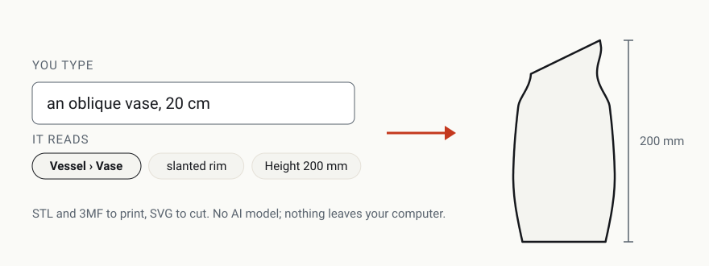

<p align="center">
  <picture>
    <source media="(prefers-color-scheme: dark)" srcset="docs/images/saymake-hero-dark.svg">
    
  </picture>
</p>

<p align="center">
  <a href="https://github.com/kinglet-dev/saymake/actions/workflows/ci.yml"></a>
  <a href="https://github.com/kinglet-dev/saymake/actions/workflows/badges.yml"></a>
  <a href="https://github.com/kinglet-dev/saymake/releases/latest"></a>
  <a href="LICENSE"></a>
  <a href="go.mod"></a>
</p>

# saymake

**Describe an object in plain words and get a shape to 3D print or laser cut:** a vase, a bowl, a mug, a tray, a coaster, a tag. Saymake reads your description, picks the object and its features, and builds a parametric shape you can fine-tune with sliders and download as STL, 3MF or SVG.

It uses no AI model and nothing you type leaves your computer: the words are matched against a hierarchy of objects and features, with forgiving spelling, and the shapes come from equations. It shows how it read your words, so a wrong guess is easy to see and fix.

[Use it on kinglet.dev](https://kinglet.dev/saymake/) · [Documentation](#usage) · [Design](docs/DESIGN.md) · [Changelog](CHANGELOG.md) · [Security](SECURITY.md) · [Releases](https://github.com/kinglet-dev/saymake/releases)

## Example

Typing **an oblique vase, 20 cm** gives:

```text
Vessel › Vase · slanted rim · Height 200 mm
Made a vase, 100.8 × 100.8 × 200 mm.
Download STL (.stl) · Download 3MF (.3mf)
```

The vase is 200 mm tall with its top cut at 25°, and every setting (height, width, bulge, neck, wall, rim slant and the rest) is on a slider. Some other descriptions to try:

- "hexagonal coaster with rounded corners, 4in" (an SVG to cut)
- "bowl, 4in diameter and raised base"
- "a mug with a thick handle"
- "orchid pot with drainage and a foot ring"
- "key tray, rectangular with rounded corners"
- "a leaning vase" (and it will tell you if it leans enough to tip over)

## What it makes

| Family | Objects | Files |
|---|---|---|
| Vessels (turned shapes, with optional flutes, sides, twist, slanted rim, lean, rim edge, raised foot and handle) | vase, bud vase, bottle, bowl, small bowl, cup, mug, teacup, candle holder, pencil cup, jar, planter, pitcher | STL, 3MF |
| Trays (a footprint with wall and floor; rounded polygon corners) | tray, serving tray, valet tray, dish, open box | STL, 3MF |
| Flat shapes (laser outlines; rounded polygon corners) | coaster, plaque (or tile), tag, bookmark | SVG |

It knows 46 features, such as "fluted", "hexagonal", "chamfered rim", "slanted rim", "leaning", "raised base", "thick handle" and "with drainage", plus sizes ("20 cm tall", "8 in wide", "height of 30 cm") and counts ("8 flutes", "6 sided").

Words it can't act on are shown, never silently dropped: "not understood", "not used" (it doesn't apply to this object), or "not supported yet" (text, lids, stems, spouts, dividers, legs, surface textures, free-form shapes, colors and materials, threads and hinges). A typo as close to two words is asked about instead of guessed.

Before offering files it checks that a solid is closed and faces outward (each part on its own), that walls are at least 0.8 mm, and warns about overhangs past 45°, wide flat ceilings, shapes that don't fit the printer (256 × 256 × 256 mm unless you change it) and shapes that would tip over.

## Usage

**In your browser:** go to [kinglet.dev/saymake](https://kinglet.dev/saymake/). Nothing to install.

**Offline:** download `saymake_<version>.html` from the [latest release](https://github.com/kinglet-dev/saymake/releases/latest) and double-click it. It's one file with everything inside, and it runs without a network connection.

1. Type what you want to make and press **Make it**.
2. Check the reading (the object, each word used, each size) and fix your words or the sliders.
3. Under **Printer**, set your printer's size if it isn't 256 × 256 × 256 mm.
4. Download the file and open it in your slicer (STL or 3MF) or laser software (SVG).

In laser software, the SVG's red lines are one layer (cut) and the dashed blue lines another (score); set each layer as you like.

**Verify a download (optional):** each release has a `saymake_<version>_checksums.txt` file. Compare it with `sha256sum saymake_*` (Linux), `shasum -a 256 saymake_*` (macOS) or `Get-FileHash saymake_*` (PowerShell). The SBOM (`saymake_<version>_sbom.spdx.json`) lists what ships.

**In another page:** each release also has the kit kinglet.dev embeds: `saymake_<version>_web.html` (the tool's markup, for inside your page), `_web.css` (its styles, all under `.saymake`), `_web.js` (a module), and `saymake_<version>.wasm` with the `saymake_<version>_wasm_exec.js` that runs it (from the Go version that built it, under Go's BSD-3-Clause license: `saymake_<version>_wasm_exec_LICENSE.txt`). Serve the `.wasm` and runner beside `_web.js` as `saymake.wasm` and `saymake_wasm_exec.js`. The page's policy needs `script-src 'self' 'wasm-unsafe-eval'` and `connect-src 'self'`.

## Compatibility

- **Browsers:** current Chrome, Edge, Firefox and Safari. The 3D preview needs WebGL 2; without it you still get the reading, the checks and the downloads.
- **Files:** binary STL in millimeters; 3MF (Core Specification 1.3) in millimeters; SVG 1.1 with its size in millimeters.
- **Accessibility:** WCAG 2.2 AA, checked with axe-core in both themes; usable by keyboard alone and at 320 px wide with 200% text.

## Configuration

The printer size, in the page. Everything else is in the description and the sliders.

## Building from source

Needs [Go](https://go.dev/dl/) 1.27 or later and [Node.js](https://nodejs.org/) 22 or later.

```sh
scripts/check.sh               # every check: format, vet, Go tests at 100% coverage, the WebAssembly run, the page's tests
(cd web && npm ci && node build.mjs)   # web/build/saymake.html, and the kit in web/build/kit/
scripts/release.sh 1.2.3       # a release's files in dist/
```

Adding an object family is one package under `families/`, registered in `internal/wiring/wiring.go`, plus its words in `adapters/vocabjson/default.json`; formats and checks plug in the same way. See [docs/DESIGN.md](docs/DESIGN.md).

## Dependencies

At run time: none beyond the Go standard library (BSD-3-Clause), compiled into the WebAssembly file, with Go's `wasm_exec.js` (BSD-3-Clause); the single-file page also carries the Outfit font (SIL Open Font License 1.1). For building and testing only: Ginkgo and Gomega (MIT), esbuild (MIT), Playwright (Apache 2.0) and axe-core (MPL 2.0, in CI only).

## Contributing

Issues and descriptions it gets wrong are very welcome; see [CONTRIBUTING.md](CONTRIBUTING.md).

## Security

See [SECURITY.md](SECURITY.md) for how to report a vulnerability and what Saymake trusts.

## License

MIT; see [LICENSE](LICENSE). The Kinglet name, logo and mascot aren't covered by it; see [TRADEMARKS.md](TRADEMARKS.md).
